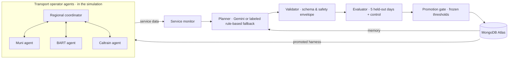

# BayFlow

**Transit agents that improve their own operations.**

BayFlow is a self-improving agent harness for San Francisco transit. Operator agents run a simulated commute on the real Muni/BART/Caltrain network. Harness agents watch how riders are served, propose a new operating architecture, test it on days it has never seen, and keep it only if it measurably wins. Every message, version and decision is stored in MongoDB Atlas.

Live read-only demo: <https://bayflow.dalrae-jin-work.workers.dev> · Source: <https://github.com/jin-dalrae/bayflow> · Earlier video (pre-fix run): <https://youtu.be/IAYM_526A10>

Hackathon track: **Recursive Harnessing**: the harness rewrites its own agent architecture and keeps a change only when held-out evaluation proves it.

## How it works



1. **Operate.** Muni, BART and Caltrain agents dispatch limited standby vehicles, hold departures for transfers, and (when a coordinator is active) post voluntary route advice. Riders are simulated cohorts with a fixed origin, destination and expected arrival, commuting between 27 neighborhoods (108 home stops) and 9 job centers (36 work stops), plus route-local trips on every published line.
2. **Monitor.** Every 15 simulated minutes the service monitor checks whether riders boarded within 10 minutes (target 80%) and how many wait in crowded queues. Two misses in a row trigger a review; otherwise the harness is kept.
3. **Propose.** The planner reads the failing traces and past lessons, then tests **one hypothesis**: a single policy parameter, rule or capability, changing at most 3 fields including required companions (enforced for Gemini and the fallback). It can change which agents and tools run, shared context, replanning cadence, bounded policy parameters, and up to 12 typed operating rules. It never writes code.
4. **Validate and evaluate.** The candidate must pass a Pydantic safety envelope, then race the current version on five held-out seeds plus a control scenario.
5. **Promote or reject.** The gate promotes only if the mean objective improves by at least 2%, at least 3 of 5 seeds win, and the control does not regress more than 5%. Rejections are stored and fed back to the planner as memory.

The interface shows the live map of riders and vehicles next to a diagram of who told whom what. Agent messages are plain-language renderings of recorded traces; every count and stop name comes from the data. A replay switch loads a candidate's test run, so a rejected architecture (for example, one with a regional coordinator) can still be inspected.

## What "better" means

The City Commute objective (`city-intent-v3`, lower is better) is fixed outside the mutation surface:

```text
J = 0.35 × (1 − share boarding transit within 10 minutes)
  + 0.35 × (1 − share arriving by original ETA + 10 minutes)
  + 0.20 × crowding exposure (passenger-minutes, normalized)
  + 0.10 × net additional operating cost / (riders × 9)
  + 1,000 × unsafe or infeasible actions
```

The cost term means one 90-unit standby bus run breaks even if about three more riders board within 10 minutes. v2 used a fixed 20,000 normalizer that made every extra run a net loss, so nothing could be promoted; v3 was declared before its runs and v2 results keep their label. Walking is not boarding, unserved riders count as missed, and accepting advice never resets a rider's original ETA. Resources are fixed (12 Muni bus, 4 Metro, 2 BART, 1 Caltrain standby pairs; 12,000 model cost units). Crowding uses assumed queue areas and a 1.5 people/m² threshold, which is a model assumption, not a safety standard. Full definitions: [demo/THESIS.md](demo/THESIS.md).

## Results so far

- **City Commute on Atlas (`city-intent-v3`):** the service monitor triggered at 4:45 PM; Gemini lowered the local dispatch trigger and the gate **promoted v36 (+3.04% held-out, 5 of 5 days)**; two further Gemini changes on top of v36 were rejected. Seed-42 objective: 0.208 evolved vs 0.226 fixed agents. Artifact: [demo/autonomous-city-v3-atlas.json](demo/autonomous-city-v3-atlas.json).
- **City Commute offline (`city-intent-v3`):** in an offline Gemini run, the planner tried a transfer-hold rule (rejected, 1 of 5 days), then lowered the local dispatch trigger: **promoted, +3.25% on held-out days, 4 of 5 days won, control within 5%**. Its next change on top of v3 was rejected. On the seed-42 replay the evolved harness scores 0.206 vs 0.226 for fixed agents, and on-time boarding rises from 67.8% to 70.2%. Artifact: [demo/evaluation-city-v3-gemini-offline.json](demo/evaluation-city-v3-gemini-offline.json).
- **What changed to make evolution meaningful:** Gemini's structured output had been rejecting the schema (`maxItems`), so proposals silently fell back to rules; demand ended at only three downtown stops; candidates bundled about six changes; standby vehicles carried riders one segment and vanished; and v2's cost normalizer made every extra run a net loss. All five are fixed; earlier city results, and the earlier video, ran under those conditions. The current 79-second video (`output/bayflow-demo-v36.mp4`) shows the v36 Atlas run.
- **Event Surge (earlier compact scenario):** a real Gemini-plus-Atlas run promoted model-generated v4 with a 22.23% lower mean objective; a later fallback proposal regressed 14.26% and was rejected. Evidence: [demo/evaluation-gemini-atlas.json](demo/evaluation-gemini-atlas.json).

Read each decision's `planner.kind` before attributing it to a model: when the model call fails or returns invalid output, the run uses the clearly labeled rule-based fallback. Between the typed-rules change and October 11, Gemini rejected the proposal schema (`maxItems`), so those city proposals are rule-based; this is now fixed.

## MongoDB Atlas

The backend uses PyMongo against the organizer's Atlas Sandbox and persists the network, runs, compressed replay frames, agent traces, harness versions, proposals, evaluations, agent memory, deployment decisions and automation events. `/database/status` verifies a real write/read round trip; the UI's Atlas indicator reflects that check. In Data Explorer, match `simulation_runs`, `agent_traces`, `harness_versions`, `mutation_proposals` and `evaluation_results` against identifiers shown in the UI.

## Run locally

Requirements: Python 3.11+, Node.js 20+, and the organizer-provided Atlas Sandbox URI.

```bash
python3 -m venv .venv && .venv/bin/pip install -r requirements.txt
(cd frontend && npm install)
cp .env.example .env   # set MONGODB_URI; optionally GEMINI_API_KEY
bash scripts/start.sh  # verifies Atlas, then serves UI :5175 and API :8000
```

Open <http://127.0.0.1:5175> and press **Run autonomous simulation** (a 3-hour window takes about 1–2 minutes). `BAYFLOW_OFFLINE=1` gives a memory-only preview that does not count as Atlas persistence. API docs: <http://127.0.0.1:8000/docs>.

Headless runs:

```bash
.venv/bin/python scripts/autonomous.py --iterations 3 --output demo/autonomous-city-atlas.json
.venv/bin/python scripts/evaluate.py --scenario city_commute --horizon-minutes 180 --seed 42 --iterations 3
```

## Static deploy

The live demo is the built UI plus a read-only export of the Atlas records, served by Cloudflare Workers static assets (no backend; Run is disabled there):

```bash
.venv/bin/python scripts/export_snapshot.py          # reads Atlas, writes frontend/public/snapshot/
cd frontend && VITE_STATIC=1 npm run build && npx wrangler deploy
```

## Tests

```bash
.venv/bin/python -m pytest -q                       # backend (74 pass, 3 external checks skipped)
cd frontend && npx tsc -b && npx playwright test     # browser checks against a running site
npx playwright test -c playwright.city.config.ts     # browser checks on fresh isolated servers
```

## Data and limitations

Geography comes from official Muni and BART GTFS feeds (3,292 nodes, 8,369 directed edges; feeds valid through late August 2026) and OpenStreetMap; see [attribution](frontend/public/data/ATTRIBUTION.md). Rider demand, disruptions, capacities and costs are synthetic; demand touches about 12% of stops, so many quiet stops never see riders. This is a simplified one-minute interval simulator, not a calibrated digital twin: it does not model full vehicle blocks, signaling, traffic or accessibility, and it controls no real equipment. Short held-out suites cannot establish broad generalization.

## More

[Thesis](demo/THESIS.md) · [Requirement audit](demo/REQUIREMENT_AUDIT.md) · [Judge FAQ](demo/JUDGE_FAQ.md) · [Live demo script](demo/LIVE_DEMO.md) · [Video notes](demo/VIDEO.md) · [Submission checklist](demo/SUBMISSION.md)

Built during the hackathon: the simulator, operator agents, harness schema, planner and fallback, evaluator and promotion gate, Atlas persistence and APIs, the React interface, tests and docs. Dependencies are existing open-source libraries.

## License

Project code is [MIT licensed](LICENSE). Third-party libraries and transit data keep their own terms. BayFlow is independent of the named agencies and implies no endorsement.
