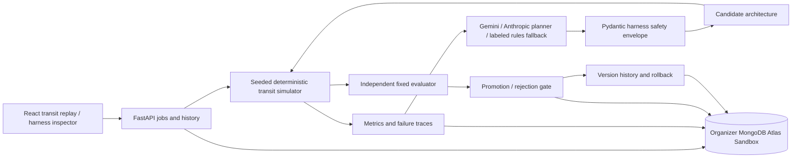

# BayFlow

**An AI transit operations system that learns to redesign how it manages a city.**

Public source: [jin-dalrae/bayflow](https://github.com/jin-dalrae/bayflow).

BayFlow is an experimental recursive agent harness for a compact San Francisco transit corridor. Operational agents respond to synthetic demand and disruption. A separate mutation planner observes their measured failures, proposes a bounded change to the agents' architecture, reruns the candidate, and promotes or rejects it using an independent evaluator.

The technical contribution is the executable architecture evolution loop. The React interface makes that loop inspectable through a transit replay, agent topology, configuration changes, and recorded decisions.

## Run locally

Requirements: Python 3.11+, Node.js 20+, npm, and the **organizer-provided MongoDB Atlas Sandbox URI**. Do not substitute a personal or newly created cluster for the official demo.

```bash
python3 -m venv .venv
.venv/bin/pip install -r requirements.txt
cp .env.example .env
# Edit .env locally; never commit credentials.
cd frontend
npm install
cd ..
```

Set `MONGODB_URI` to the official Sandbox connection string. `MONGODB_DB` defaults to `bayflow`. The model planner supports Gemini through Google's official `google-genai` SDK and Anthropic through its official SDK. The default configuration is `LLM_PROVIDER=gemini`, `GEMINI_API_KEY`, and `GEMINI_MODEL=gemini-3.8-flash`; `GOOGLE_API_KEY` is accepted as an alias. For Anthropic, set `LLM_PROVIDER=anthropic`, `ANTHROPIC_API_KEY`, and `ANTHROPIC_MODEL`. A missing key, provider failure, or invalid response triggers the visibly labeled rule-based planner, with its actual fallback reason recorded. `TRANSIT_511_API_KEY` is only needed for the optional GTFS importer.

Gemini generation uses JSON Schema structured output, followed by application validation; see [Google's structured-output documentation](https://ai.google.dev/gemini-api/docs/generate-content/structured-output). A **real Gemini 3.8 Flash proposal call passed** the opt-in model test and produced a validated candidate. [Its preserved artifact](demo/model-verification.json) records `planner.kind=llm`, provider/model, 8,852 input tokens, 659 output tokens, and 1,566 thinking tokens. This proves model-driven proposal generation; candidate improvement still requires a separate measured simulation evaluation. The optional Anthropic credential encountered an insufficient-credit error during verification, so it is not used as evidence of successful model planning.

A subsequent **real Gemini-plus-Atlas evolution run** proposed and promoted v4 with **22.23% lower mean promotion-suite objective**. Its proposal metadata confirms Gemini `gemini-3.8-flash`; the decision and before/after evaluations were read back through the persisted proposal-history endpoint. On iteration two, Gemini's response failed strict Pydantic validation, so the explicitly labeled rule-based fallback proposed v5. Its objective worsened **14.26%**, and the gate rejected it, retaining v4. [The complete actual artifact](demo/evaluation-gemini-atlas.json) includes job history/results, persisted proposal readback, and verified database state. This establishes model-driven mutation, executable candidate evaluation, automatic promotion/rejection, schema enforcement, and actual Sandbox auditability together; it does not claim two valid LLM proposals.

After configuring `.env`, the single launcher verifies actual Atlas ping/read/write, seeds the database, and starts both services:

```bash
bash scripts/start.sh
```

The launcher serves the interface at <http://127.0.0.1:5175> and the API at <http://127.0.0.1:8000>. If Atlas verification fails, it still starts the interface, but official operations remain blocked until access works; offline preview requires explicit selection. To verify database access separately:

```bash
.venv/bin/python scripts/verify_atlas.py
```

**Verified Atlas integration:** The official Sandbox ping/read/write and live recursive evaluation have passed. [The actual Atlas evaluation artifact](demo/evaluation-atlas.json) records `persistence=atlas`, measured decisions, matching run identifiers, and database verification. A live snapshot contained 21 runs, 1,785 frames, 5,516 traces, three versions, two proposals, two evaluations, and two deployment decisions; these counts grow with further runs. Recheck database status before presenting.

Manual launch, if preferred:

Start the backend from the repository root:

```bash
.venv/bin/uvicorn backend.app.main:app --host 127.0.0.1 --port 8000
```

In another terminal:

```bash
cd frontend
npm run dev -- --port 5175
```

Open <http://127.0.0.1:5175>. API documentation is at <http://127.0.0.1:8000/docs>. Check `/database/status` before presenting: a successful connection alone is insufficient; the backend must also confirm a real write/read round trip.

For an explicitly noneligible development preview, set `BAYFLOW_OFFLINE=1`. Offline state is not Atlas persistence and cannot meet the competition acceptance criteria. Return to `BAYFLOW_OFFLINE=0` with the official URI before the hackathon demo.

## Architecture and recursive harnessing



Harness v1 has independent Muni, BART, and Caltrain agents, local dispatch tooling, a 30-minute horizon, a 15-minute replanning interval, local-only context, six memory steps, basic verification, and local-greedy optimization. It is functional but has limited regional coordination.

The schema permits only known agents and tools, bounded horizon/replanning/memory parameters, and enumerated coordination/context/verification/strategy values. Companion-agent requirements constrain regional coordination and forecasting. The planner changes this configuration rather than generating executable code. Evaluator weights and scenario parameters are outside the harness mutation surface.

Every iteration diagnoses measured failures, creates a proposal, validates it, evaluates the candidate against its incumbent on matched scenarios/seeds, and records the resulting acceptance or rejection. A favorable prediction from a planner never counts as measured improvement. Historical versions can be inspected and explicitly rolled back.

The development run uses the requested seed. Each candidate is compared with its incumbent on three preselected held-out event-surge seeds: `seed+1001`, `seed+2003`, and `seed+3001`. A commuter control uses `seed+5003`. Promotion requires at least **2% lower mean held-out objective**, **zero candidate feasibility violations**, and **no more than 5% commuter objective regression**. Default evolution runs two iterations. These gates are fixed independently of the planner. The final three-way display reruns all three modes on the original seed; distinguish that demonstration comparison from the held-out promotion scores.

The planner receives observed development failures and prior evaluated proposal acceptance/rejection history, without numerical held-out scores. This allows it to change its architectural hypothesis after a rejected candidate. The same held-out suite is reused across adaptive iterations; it is a promotion benchmark, not an independent statistical claim of generalization. A fresh final test suite would be needed for that claim.

## Scenario and data provenance

**The Bay Area Event Surge** is a seeded, fictional weekday evening from 4:00–11:00 PM. It includes a driver gap at 5:20, a BART delay at 6:10, Chase Center demand at 8:45, Oracle Park demand at 9:30, and possible cascading queues afterward. These are scenario parameters, not historical event claims.

The compact topology uses approximate real station coordinates and actual interagency transfer geography around Oracle Park, 4th & King, Mission Bay, downtown BART, Balboa Park, and Millbrae. Muni Bus, Muni Metro, BART, Caltrain, and walking connections are represented. Intermediate stops are compressed into directed corridor segments; no full regional GTFS reconstruction is claimed.

| Data | Classification | Default runtime use |
| --- | --- | --- |
| Station names, approximate coordinates, transfer geography | Manually curated/derived | Yes |
| Headways, travel minutes, segment capacities, fleet/driver constraints | Synthetic assumptions | Yes |
| Passenger OD demand and fictional disruptions | Seeded synthetic | Yes |
| 511 GTFS schedules | Optional published observations | Import/archive only; not automatically used by simulator |
| BART hourly OD ridership | Potential calibration source | Not imported or used in the default demo |
| SFMTA/Caltrain empirical ridership | Potential calibration source | Not imported or used in the default demo |

Official [511 transit documentation](https://511.org/open-data/transit) describes bulk GTFS feeds and the `operator_id=RG` regional feed. Access requires a token; see [511 FAQs](https://511.org/open-data/faqs). Optional feed use is governed by the [511 Data Disseminator Agreement](https://511.org/sites/default/files/2026-04/511_Data_Agreement_Final_2026.pdf), not this repository's MIT license. Imported views must display **“data provided by 511.org”** with a link near the data. No transit agency logos are required or supplied. [BART ridership reports](https://www.bart.gov/about/reports/ridership) are identified as a future calibration source, not evidence that the synthetic demand matches observed ridership.

Optional importer:

```bash
# Parse a previously downloaded GTFS ZIP without database writes.
.venv/bin/python scripts/import_gtfs.py --zip /path/to/feed.zip --dry-run
# Download official RG feed using TRANSIT_511_API_KEY and persist a corridor slice.
.venv/bin/python scripts/import_gtfs.py
```

The importer reads stops, routes, trips, stop times, calendars, shapes, and available transfers, handles optional missing files, and stores SHA-256, timestamp, source, bounding box, transformation, and row counts in `gtfs_imports`. Associated records use `gtfs_*` collections. It does not overwrite the curated runtime graph or claim demand calibration. A supplied ZIP must have its publisher verified by the participant. No raw feed is distributed in this repository.

## MongoDB evidence

Use the official PyMongo driver. The backend creates collection indexes and persists scenarios/network, runs, agent observations/actions, harness versions, proposals, evaluations, memory, and deployment decisions. The UI database indicator reflects actual backend status; it must not infer persistence from an animation.

In Atlas Data Explorer, select the configured database and inspect `simulation_runs`, `agent_traces`, `harness_versions`, `mutation_proposals`, and `evaluation_results`. Match run/version/proposal identifiers from the UI. Refresh after an evolution and verify new documents and the active-version decision. Never show a URI, `.env`, or token on screen.

`GET /harness/proposals` joins persisted proposals with candidate configurations and before/after evaluation history. The inspector can reload this audit trail after a browser refresh instead of depending on the last in-memory job result.

## Evaluation and reproducibility

The three comparison modes are static timetable (no intelligent intervention), fixed agents (operational actions with unchanged v1), and recursive harness (operational actions plus evaluated architecture mutations). Matching seeds and a fixed objective distinguish ordinary operational improvement from recursive improvement.

The simulator advances in five-minute intervals. Seeded OD cohorts follow a shortest expected-time path; queues board up to each modeled departure's capacity, and arrivals advance to their next segment. Walking links connect distinct station/operator nodes. Muni standby interventions share a pool of three vehicle/driver pairs, each reserved for a modeled turn cycle. Driver gaps cancel alternate bus departures; the BART disruption cancels alternate departures and adds five minutes to travel. These constraints are deliberately simplified.

Passenger delay is arrival time minus the earliest journey on **the same selected path** with undisrupted synthetic headways and unlimited capacity, clipped at zero. The reference is synthetic, not an observed published agency schedule. Unfinished journeys receive an explicit terminal charge `max(0, 420 - reference_arrival_minute + 30)` per passenger. This discourages leaving passengers unserved to improve the reported score. Average delay divides all completed and terminal charges by generated passengers. Transfer failures include capacity denial or waiting longer than a modeled connection headway; denied-boardings congestion counts can include repeated denial of the same passenger.

The fixed lower-is-better objective is:

```text
J = 0.50 × (average passenger delay / 30 minutes)
  + 0.20 × missed transfer rate
  + 0.20 × (unserved passengers / generated passengers)
  + 0.10 × (additional operating cost / 20,000)
  + 1,000 × (capacity violations + feasibility violations)
```

Congestion, queue peaks, wait time, occupancy violations, feasibility, and served/queued/onboard accounting are reported alongside the objective. Operating costs are synthetic scenario units, not quoted agency budgets. Evaluator `objective-v1` and its weights are stored with runs and cannot be changed by a harness proposal.

Run isolated tests, opt-in integration checks, and the frontend build:

```bash
npm test -- -q
# Real official Sandbox integration; requires its configured URI.
npm test -- --atlas -q
# Real configured model call; requires an available provider/model and key.
npm test -- --llm -q
# Both external integration checks.
npm test -- --atlas --llm -q
cd frontend
npm run build
```

The standard suite passes 22 isolated tests and skips the two opt-in checks. The actual Atlas integration check also passed. `npm test -- --llm -q` passed 23 tests with the Atlas check skipped, including a real Gemini 3.8 Flash request and parsed validated proposal. Two live browser checks passed, including real Atlas baseline write/read and traces from all three operator controllers. Live UI checks default to port 5175 and accept `BAYFLOW_UI_URL` to override the address. Provider configuration alone is not proof of a successful model call: inspect the proposal's `planner.kind`, provider/model, and token metadata.

Run the entire recursive loop without a browser (official Sandbox required):

```bash
.venv/bin/python scripts/evaluate.py --seed 42 --iterations 2 --output demo/results-atlas.json
# Reproducible rule-based planner; still uses Atlas by default.
.venv/bin/python scripts/evaluate.py --rule-based --seed 42 --iterations 2
# Explicit isolated preview, with no database eligibility claim.
.venv/bin/python scripts/evaluate.py --offline --rule-based --seed 42 --iterations 2
```

The CLI prints real stage updates to stderr and measured results to stdout. `--output` saves the summary, not a video or proof of external publication. Repeated Atlas runs start from the current persisted harness; inspect version history or roll back to v1 when you need a fresh v1 comparison. Rollback records a decision; rejected candidates cannot be activated.

## API

| Endpoint | Behavior |
| --- | --- |
| `GET /health` | Process status, Atlas status, configured-model indicator |
| `GET /network` / `GET /scenarios` | Curated graph and scenario definitions |
| `POST /simulation/run` | Enqueue real simulation (`mode`, `seed`, `scenario`) |
| `GET /jobs/{job_id}` | Actual job status, stage history, result or failure |
| `GET /simulation/{run_id}` | Persisted summary, frames, and traces |
| `GET /simulation/{run_id}/frames` | Replay frames from persistence |
| `GET /harness/current` / `GET /harness/versions` | Active configuration and version history |
| `POST /harness/evolve` | Enqueue candidate planning and independent evaluations |
| `GET /harness/evaluations` | Persisted evaluation/gate results |
| `GET /harness/proposals` | Persisted proposal/configuration/evaluation audit history |
| `POST /harness/rollback` | Activate a prior accepted version and audit the decision |
| `GET /database/status` | Ping/read-write status and collection counts |

Example requests while the backend is running:

```bash
curl -sS http://127.0.0.1:8000/database/status
curl -sS -X POST http://127.0.0.1:8000/simulation/run \
  -H 'Content-Type: application/json' \
  -d '{"mode":"fixed","seed":42,"scenario":"event_surge"}'
curl -sS -X POST http://127.0.0.1:8000/harness/evolve \
  -H 'Content-Type: application/json' \
  -d '{"seed":42,"iterations":2,"use_llm":true}'
# Substitute the actual returned job_id; poll until completed or failed.
curl -sS http://127.0.0.1:8000/jobs/ACTUAL_JOB_ID
curl -sS -X POST http://127.0.0.1:8000/harness/rollback \
  -H 'Content-Type: application/json' -d '{"version":"v1"}'
```

Long-running operations return HTTP 202 with a job ID. Polling `/jobs` reflects backend progress rather than cosmetic frontend stages. Only one evolution/rollback can run at once. An explicit request `offline:true` selects in-memory preview; historical query endpoints accept `?offline=true` for that store. Preview data disappears when the process exits. Job results are available in the running process; after restart inspect persisted run/evaluation endpoints instead.

## Measured offline results

[The preserved evaluation artifact](demo/evaluation-offline.json) contains actual rule-based planner results from a fresh offline seed-42, two-iteration run. Its UUIDs identify the executed offline runs; they are not Atlas document evidence. Both candidates were rerun under the fixed evaluator: neighbor coordination v2 improved mean promotion-suite objective only **0.83%** and was rejected; a subsequent regional shared-context v3 with 60-minute horizon and five-minute replanning improved it **22.23%** and was promoted. The planner selected this second mutation after observing residual failures and the previous rejection.

| Seed-42 demonstration metric | Static timetable | Fixed agents v1 | Promoted harness v3 |
| --- | ---: | ---: | ---: |
| Objective, lower is better | 0.403408 | 0.305224 | 0.240118 |
| Average delay, minutes | 20.235 | 15.131 | 11.563 |
| Served passengers | 3,394 | 3,827 | 3,992 |
| Unserved passengers | 1,651 | 1,218 | 1,053 |
| Additional operating cost, synthetic units | 0 | 810 | 990 |
| Missed-transfer rate | 0.00354 | 0.00354 | 0.00354 |
| Repeated capacity denials | 7,156 | 4,681 | 6,334 |

All modes generated the same **5,045** passengers. The evolved seed-42 objective is **21.33% lower** than fixed agents, at **22.22% higher additional operating cost**. Some metrics did not improve: transfer failures were unchanged and repeated boarding denials increased. These measured tradeoffs are preserved rather than hidden. Promotion uses the mean matched held-out suite, not this single demonstration percentage. The [Atlas-backed run](demo/evaluation-atlas.json) reproduced this three-way comparison and persisted its proposals, evaluations, and decisions. Both preserved evaluation artifacts used the rule-based planner. Future runs, model proposals, and persisted starting versions may produce different results.

The later [Gemini-plus-Atlas run](demo/evaluation-gemini-atlas.json) retained model-generated champion v4 and reproduced the same seed-42 comparison shown above. Its first mutation used the real LLM and was promoted; its second iteration used the labeled fallback after an invalid model response and was rejected. Read each decision's planner metadata rather than assigning one provider label to the whole run.

## Limitations

This is a simplified interval simulator, not a calibrated transport digital twin. Capacities refer to modeled segment departures; it does not reproduce physical fleet circulation, signaling, complete timetables, traffic, accessibility constraints, or actual dispatch systems. Demand and resource assumptions need empirical calibration. Regional low-threshold standby dispatch is enabled only during observed Muni overload, so low-load commuter demand does not consume the same reserve policy. Results demonstrate behavior in selected synthetic scenarios rather than proven real-city benefits. The system controls no real transit equipment. Reused promotion seeds and a short hackathon evaluation cannot establish broad generalization or long-term stability of architectural evolution.

## Demo and submission

Use [the three-minute live script](demo/LIVE_DEMO.md), [one-minute video plan](demo/VIDEO.md), [judge FAQ](demo/JUDGE_FAQ.md), and [submission evidence checklist](demo/SUBMISSION.md). Main flow: run baseline → inspect failure → evolve harness → inspect evaluated diff and acceptance/rejection → replay → inspect Atlas records.

The [public repository](https://github.com/jin-dalrae/bayflow) has been created and official Sandbox persistence has been verified. A submission video has not been recorded or uploaded; the included video file is a recording script. Video recording/upload and the participant's submission form remain required before the 5:00 PM Pacific deadline.

## What We Built During the Hackathon

The implementation authored for this build comprises the seeded transit simulator; operational agents; validated runtime harness schema; architecture mutation planner and explicit deterministic fallback; independent candidate evaluation and promotion/rollback; MongoDB persistence and APIs; React simulation replay and harness inspector; tests; optional GTFS importer; and demo/documentation artifacts. This section describes the new code's scope, not a claim that every external integration has been verified. Verification results and any incomplete requirements must be reported from actual execution.

Python/React and other dependencies are existing open-source libraries. Real place names and geography are identified separately from new software. Default scenario data is newly generated synthetic data. Optional imported datasets retain their providers' terms.

## License

New project code is [MIT licensed](LICENSE). Third-party libraries retain their own licenses; imported transportation data retains its provider terms. BayFlow is independent of the named transit agencies and does not imply their endorsement.
